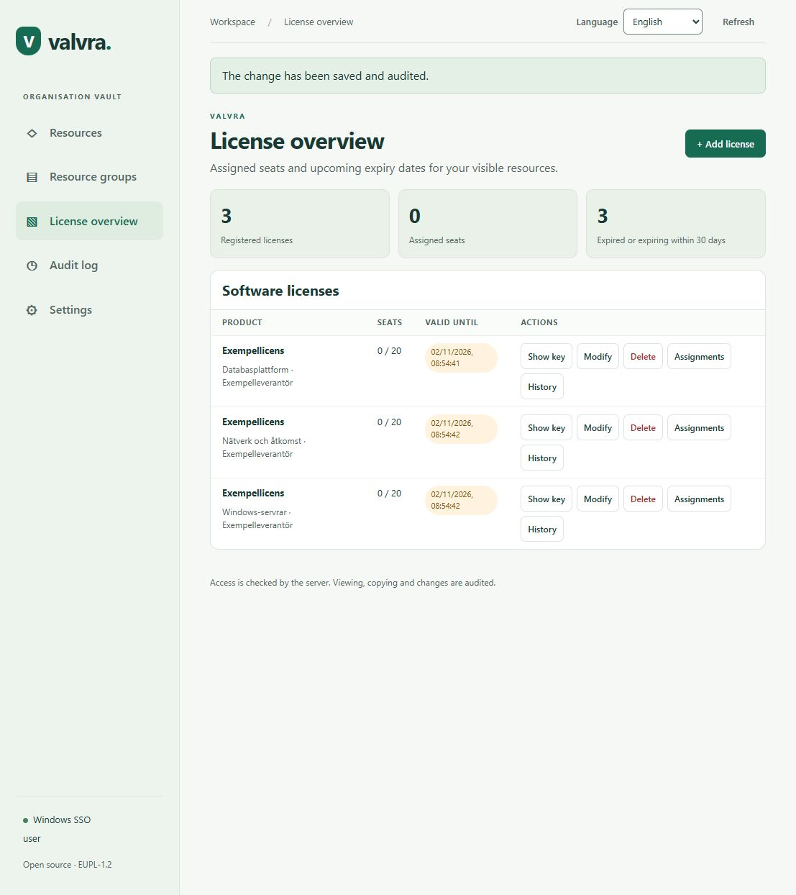
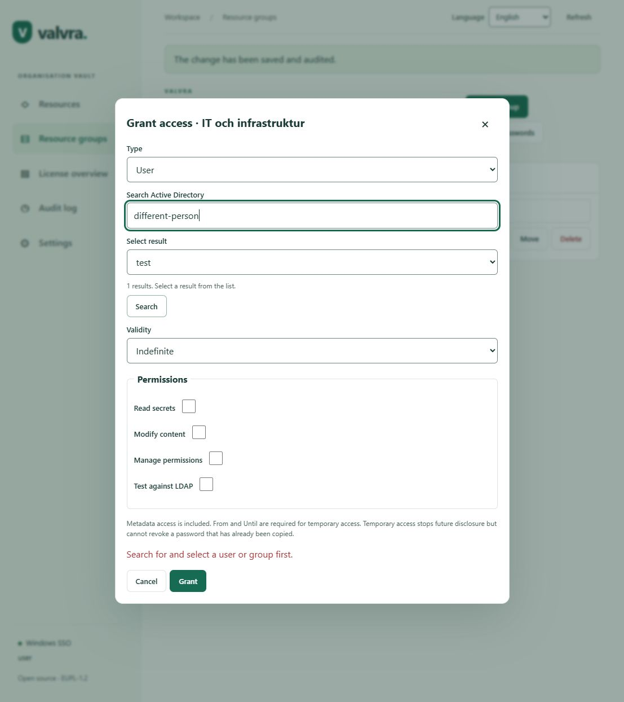
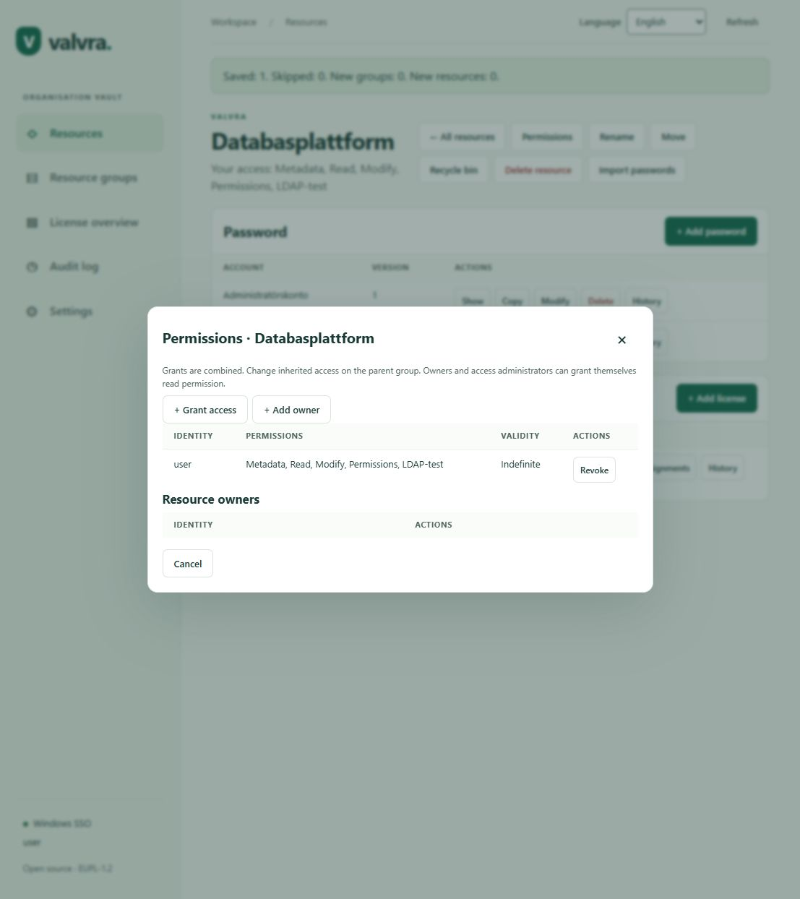
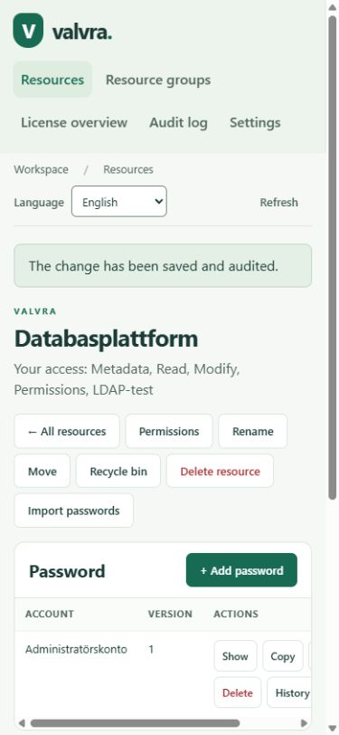
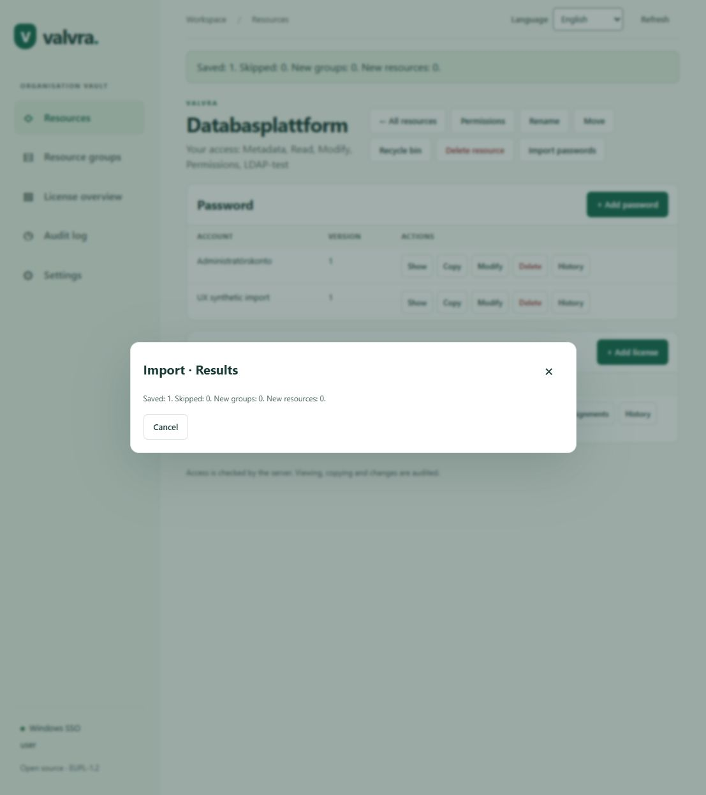

# Valvra UX review and overhaul brief

Reviewed 2026-10-13. This is a review of the current working checkout, including existing uncommitted work, rather than proof of behavior in the deployed installation.

## Scope and evidence

An independent UX/UI review agent inspected the implementation. The primary reviewer exercised the application in an isolated loopback preview with synthetic identities and data: resources, resource details, groups and group actions, permissions, directory search, grant cancellation, temporary-access controls, import, license overview, audit, and settings. Desktop and a 390 × 844 mobile viewport were inspected. No real directory, credential, production database, or certificate was changed. A synthetic resource rename was saved without changing its name, and one synthetic password entry was imported.

Evidence labels: **Live** means observed through the preview UI; **Source** means implementation inspection; **Requirement** means requested behavior; **Unresolved** means the user's reported failure was not established in this environment. Priorities: P1 before the overhaul ships; P2 in the main overhaul; P3 subsequent refinement.

## Findings and proposed behavior

| ID | Priority / evidence | Weak point and impact | Proposed behavior |
| --- | --- | --- | --- |
| UX-01 | P1 · Live + Source | A successful save displays “The change has been saved and audited” on unrelated pages indefinitely. Reproduced by saving Rename, then opening Licenses, Audit, and Settings. Refresh messages also persist. | Action-specific, dismissible success feedback with a bounded lifetime; clear stale feedback on navigation. Keep actionable errors available until dismissed or resolved. Announce success without moving focus. |
| UX-02 | P1 · Source + user report | Permission and owner rows render `subjectId`; real AD identities therefore appear as SIDs. The preview uses the synthetic ID `user`. People cannot confidently recognize recipients. | Display name, account name, user/group type, and provider where needed. Retain the stable ID as secondary details and as the authorization identifier. If resolution fails, show “Unresolved identity” and the ID, preserving the row. |
| UX-03 | P1 · Live + Source | Enter in Search Active Directory submits Grant rather than searching. With no selected recipient it shows “Search for and select a user or group first.” | Enter in the search field executes search only. Grant requires an explicitly selected recipient and a separate deliberate submission. |
| UX-04 | P1 · Live + Source | Search automatically selects its first result. Changing the query leaves the previous recipient selected. In the preview, changing `test` to `different-person` left recipient `test` selected. | Start with no selection; clear recipient selection when search text/type changes; discard out-of-order search responses. Show the selected account and permission scope before submission. |
| UX-05 | P1 · Live + Source | Adding access replaces the permissions overview; Cancel closes the entire workflow. Read-only permissions and import results also say “Cancel.” | A persistent permissions page/panel with an add/edit step that returns to the updated overview. Use Back, Cancel changes, and Close according to their actual effect. Preserve parent context and focus. |
| UX-06 | P1 · Source | Inherited access is only labeled “Inherited.” There is no source path or edit route, and direct grants are not distinguished from effective access. | Show direct grants, inherited grants with source-group links, and an explanation of effective rights. Revoking one grant must explain when another grant continues to provide access. |
| UX-07 | P1 · Source | Revoke and Remove owner execute immediately; ordinary buttons have no shared pending-state guard. Consequences are hard to assess. | Confirm recipient and scope, explain inherited access that remains, prevent repeated submissions, and report completion inside the permissions workflow. |
| UX-08 | P1 · Requirement + Source | Import is currently offered to ordinary users with a writable destination. It orchestrates normal create APIs, with no import-specific administrator boundary. | Put Import under administration. Recommended role: Access Administrator, in addition to destination content permissions. Add an authorized server import operation; hiding the button alone is insufficient. Preserve normal manual creation for authorized content editors. |
| UX-09 | P1 · Unresolved + Live + Source | The reported import failure was not reproduced with a one-row UTF-8 CSV into an existing writable resource: saved 1, skipped 0, destination item visible. Execution catches failures and discards their cause, so real failures cannot be understood from the result. | Expose safe operation/row diagnostics, partial counts, uncertain-write status, and clear retry guidance. Never include source passwords or sensitive field contents. Reproduce the failing file shape and destination rights before declaring the reported issue fixed. |
| UX-10 | P2 · Live + Source | Settings renders the long AD configuration before global permissions for someone with both roles. The most frequent administrative task is buried. | Separate sections with tabs/navigation: People & permissions, Import, Directory, Certificates & security, About. Default to People & permissions for access administrators; preserve role-specific visibility. |
| UX-11 | P2 · Live + Source | Expanding Group actions adds buttons inside the hierarchy row and changes its layout. | An anchored actions menu that does not resize the row, supports keyboard navigation, Escape/outside dismissal, and returns focus to its trigger. |
| UX-12 | P2 · Source + user report | “Move” is vague; destination options use bare group names, and the preview does not clearly compare before/after access. | “Move to another group…” with full source/destination paths, invalid destinations excluded, subtree impact explained, and added/removed/retained access summarized before committing. |
| UX-13 | P2 · Live + Source | AD group can remain selected with “Temporary read access – users only.” The incompatible state is accepted by the UI and rejected later. | Constrain recipient type immediately, explain the restriction, and validate start/end order locally while retaining server validation. |
| UX-14 | P2 · Live + Source | Resource details have seven header actions and five actions per content row. At 390 px, actions require horizontal table scrolling and the navigation/header consume much of the first screen. | Prioritize Show/Copy and Add; put secondary actions in consistent menus. Use a mobile row/detail layout with essential actions reachable without horizontal searching. Separate destructive actions visibly. |
| UX-15 | P2 · Live + Source | Resource overview only offers cards and name search; the count is visually hidden. Hierarchy renders every branch without branch-collapse controls. | Visible count and active filters, clear filters, compact sortable list option, collapsible groups. Validate against larger hierarchies and duplicate names. |
| UX-16 | P2 · Live + Source | License overview has no search, sort, or actionable expiry summaries. Add license **does exist in this checkout** when a Metadata+Modify destination exists; absence in the installation remains unresolved. | Keep Add license discoverable with an explanation when no destination is writable. Make expiry/seat summaries filters, add search/sort, and verify the deployed version and session rights before diagnosing a missing button. |
| UX-17 | P2 · Live + Source | Audit expects actor IDs and operation codes. Previous/Next remain available at boundaries. Export reads current field values, which may differ from applied filters. | Identity lookup, readable operation choices, explicit applied-filter state, boundary-aware pagination, and export tied to the displayed query. Preserve verified-event filtering and invalid-signature handling. |
| UX-18 | P2 · Live + Source | After Rename, the audit results table is exposed as “Rename” to accessibility tools. The shared table helper falls back to the stale dialog title even when no dialog is open. | Table captions/regions must use their containing section or explicit title; use a dialog title only for a table inside that active dialog. Verify names across navigation after dialogs close. |
| UX-19 | P2 · Source | Content is cleared before some asynchronous reads complete, with limited loading/retry feedback. | Region-specific progress, empty states distinct from loading/failure, and targeted Retry without losing filters or navigation context. |
| UX-20 | P2 · Requirement + Source | No version is visible in the inspected shell. `Directory.Build.props` currently declares 1.2.2, which does not establish the deployed version. | A quiet footer version and About details sourced from the running assembly/build metadata, including commit when available. Avoid a hardcoded UI version. |
| UX-21 | P2 · Requirement + Source | Certificate lifecycle is absent from Settings. Encryption-key rewrapping already exists as an operator CLI workflow, not a browser operation. | Start with role-restricted certificate purpose/status/expiry and guided rotation instructions. Distinguish TLS, encryption, audit signing, and integrity certificates. Browser-triggered rotation needs a separate operational design. |
| UX-22 | P3 · Source | Secret-history navigation replaces its parent dialog, and the 30-second reveal expiry has no visible remaining-time indicator. | Return-to-history navigation and a remaining-time indicator. Retain secret clearing on blur, hidden document, timeout, and dialog close. |

## Source anchors

- Shared notices, dialog lifecycle, and captions: [app.js](../src/Valvra.Web/wwwroot/js/app.js), lines 50–68, 102–116, 134–137.
- Import visibility and browsing: `app.js`, lines 171–225; group actions/hierarchy at 227–255; detail actions at 302–320.
- Directory picker and permissions: `app.js`, lines 417–459; Move at 461–473; License overview at 491–501; Audit at 579–620.
- Import planning/execution/results: [import.js](../src/Valvra.Web/wwwroot/js/import.js), lines 78–142 and 177–291.
- Settings ordering and identity search: [settings.js](../src/Valvra.Web/wwwroot/js/settings.js), lines 10–132.
- Shell and absent build information: [Index.cshtml](../src/Valvra.Web/Pages/Index.cshtml); declared version: [Directory.Build.props](../Directory.Build.props).
- Rotation entry point: [Program.cs](../src/Valvra.Web/Program.cs), lines 124–138; [KeyRotationService.cs](../src/Valvra.Infrastructure/Services/KeyRotationService.cs); [operator instructions](OPERATIONS.md#certificate-rotation).

## Proposed experience

Keep the main navigation focused on Resources, Resource groups, Licenses, Audit, and Administration. Within Administration, place People & permissions and Import ahead of Directory and Certificates & security. About exposes running version/build information. Use links/routes for sections so browser history and deep links work; use accessible tab semantics only if the implementation is an actual tab widget.

Permissions should answer four questions in order: who has access, what they can do, where that access comes from, and how long it lasts. A readable identity column and source path should be visible without opening extra dialogs. Adding access follows Select recipient → Choose permissions/duration → Review scope → Grant → Updated access list. Metadata-only access should be an explicit meaningful choice rather than the accidental result of leaving every checkbox empty.

Import should follow Select file → Map columns and destination → Review → Import → Results. Show a step indicator, safe format example, clear destination rights, and actionable failure details. Retain the current masked preview, duplicate skipping, no overwriting, per-change audit, partial-completion reporting, and secret clearing. Explain the need to reselect the file after focus loss; do not silently weaken that protection to make the wizard seem smoother.

For administrator-only import, Access Administrator is the proposed existing role, not a new blanket vault read/write privilege. The backend must freshly authorize the import operation and each destination. A dedicated import API can enforce who may use that operation; ordinary manual create APIs remain available according to content permissions, so this is not a claim that repeated manual creation can be prohibited by labeling it “bulk.” No change should silently grant an administrator access to secret contents.

Certificates & security should first make the current operator process understandable. Encryption rewrapping, audit verification retention, integrity checkpoint verification, and TLS replacement have different requirements. A future browser operation would need recoverability, retained old keys, progress/restart behavior, authorization, and audit designed together.

## Delivery order and acceptance criteria

1. **Permissions and feedback:** fix stale notices, Enter behavior, explicit recipient selection, pending states, display identities, inheritance sources, and parent-context navigation. Verify two people with similar names, stale/out-of-order searches, unresolved SID, inherited-only access, temporary access, and revoke-with-remaining-inheritance. Search Enter must never grant access.
2. **Import:** implement the administrator boundary and improve diagnosis; reproduce the reported failing path. Verify authorized administrator with/without destination rights, ordinary editor denial on the import endpoint, partial completion, duplicate retry, uncertain write, focus loss, malformed CSV, and two-level hierarchy mapping. Imported plaintext must not reach logs, persisted browser storage, or preview HTML.
3. **Administration and shell:** introduce sections/tabs, default to permissions for access administrators, expose runtime version, and add certificate status/runbook. Verify role visibility, keyboard navigation, reload/deep links, and unsaved-settings handling.
4. **Browsing and actions:** stabilize group menus, clarify Move with access deltas, reduce resource action density, improve mobile rows, add compact browsing and license filters. Verify duplicate group names and larger trees rather than only three resources.
5. **Audit and consistency:** fix table names, applied-filter/export behavior, loading/retry states, pagination boundaries, and read-only Close language across dialogs. Validate full task completion with keyboard and assistive technology as well as automated accessibility checks.

## Validation performed and limits

- Release preview build succeeded using existing restored dependencies: zero warnings/errors.
- Nine existing Node import tests passed, covering parsing, mapping, planning, duplicates, cancellation, and uncertain writes. These test the current policy, which is not administrator-only.
- Manual UI import: a one-row synthetic CSV was read, mapped, previewed, imported, and verified in the destination list. This does not establish production import success or all file formats.
- Stale save banner, Enter submission, automatic/stale recipient selection, lost permissions context, blank permission tables, incompatible temporary-recipient controls, settings ordering, and mobile action overflow were observed live.
- Existing accessibility/browser tests were inspected; the full browser suite and manual screen-reader audit were not run in this review. No production deployment, real AD name resolution, certificate rotation, or production import failure was validated. Large-data behavior remains to be tested.
- No application implementation changes were made in this review. Existing setup work was preserved.

## Screenshots

Saved success feedback on an unrelated license page:

Search text changed while the previous recipient remains selected:

Populated resource permissions with raw synthetic identity and empty owner table:

Mobile resource action density and horizontal table navigation:

Successful synthetic import result:

